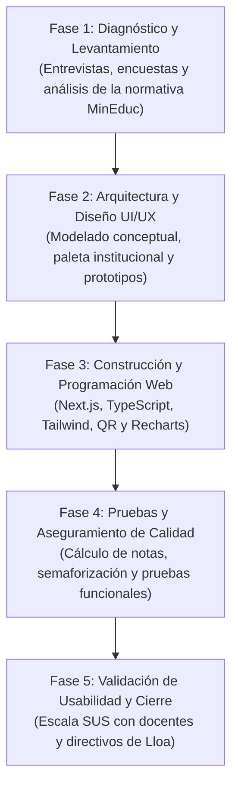

# TECNOLÓGICO UNIVERSITARIO RUMIÑAHUI
## DIRECCIÓN DE INVESTIGACIÓN Y POSGRADOS / UNIDAD DE INTEGRACIÓN CURRICULAR (UIC)
### CARRERA: TECNOLOGÍA SUPERIOR EN DESARROLLO DE SOFTWARE

---

**TRABAJO DE TITULACIÓN PREVIO A LA OBTENCIÓN DEL TÍTULO DE:**  
**TECNÓLOGO SUPERIOR EN DESARROLLO DE SOFTWARE**

---

### TEMA:
**DESARROLLO E IMPLEMENTACIÓN DE UN SISTEMA WEB DE GESTIÓN ACADÉMICA, CONTROL DE CALIFICACIONES TRIMESTRALES Y ANALÍTICA DE ALERTA TEMPRANA DE DESERCIÓN ESCOLAR PARA LA ESCUELA DE EDUCACIÓN BÁSICA "PICHINCHA", PARROQUIA LLOA, PERÍODO LECTIVO 2024-2025**

---

**AUTOR:**  
Cumbajin, Jostyn  
Correo electrónico: jostyn0306@gmail.com  
Matriz: Sangolquí – Ecuador  

**DIRIGIDO POR / TUTOR:**  
[Apellidos y Nombres del Tutor Asignado]  
Título: [Título Académico del Tutor]  
Matriz: Sangolquí – Ecuador  
Correo electrónico: [Correo Institucional del Tutor]  

**FECHA DE PRESENTACIÓN:**  
Noviembre, 2024 (Período Lectivo 2024-2025)

---

### DERECHOS DE AUTOR Y DECLARACIÓN DE RESPONSABILIDAD

Todos los derechos reservados. Queda prohibida, salvo excepción prevista en la Ley, cualquier forma de reproducción, distribución, comunicación pública y transformación de esta obra para fines comerciales, sin contar con autorización de los titulares de propiedad intelectual. La infracción de los derechos mencionados puede ser constitutiva de delito contra la propiedad intelectual. Se permite la libre difusión de este texto con fines académicos investigativos por cualquier medio, con la debida notificación a los autores.

© 2024, Tecnológico Universitario Rumiñahui  
Sangolquí – Ecuador

---

## DEDICATORIA
*(Opcional / Sección Preliminar)*  
A mi familia, por su incondicional respaldo y apoyo moral a lo largo de este camino formativo; a los docentes de la institución que forjaron mi pensamiento analítico y técnico; y a la comunidad de la parroquia rural de Lloa, en especial a los niños, niñas y maestros de la Escuela de Educación Básica "Pichincha", cuya perseverancia diaria inspiró el desarrollo del presente proyecto.

---

## AGRADECIMIENTOS
*(Opcional / Sección Preliminar)*  
Al Tecnológico Universitario Rumiñahui por brindarme las herramientas, espacios y conocimientos necesarios para convertirme en un profesional del desarrollo de software con compromiso social y rigor técnico.  
A las autoridades y docentes de la Escuela de Educación Básica "Pichincha", por abrir sus puertas, facilitarnos la comprensión de sus flujos operativos y permitirnos transformar una necesidad real en una solución tecnológica de impacto directo.  
A mi tutor, por sus orientaciones metodológicas y pedagógicas en cada una de las fases de este trabajo de titulación.

---

## RESUMEN EJECUTIVO

El presente proyecto de titulación aborda la problemática de la gestión de información académica y la detección tardía de factores de riesgo de deserción en la Escuela de Educación Básica "Pichincha", ubicada en la parroquia rural de Lloa, cantón Quito. Históricamente, la institución ha registrado la asistencia, calificaciones e incidencias en hojas de papel y hojas de cálculo desarticuladas, lo cual genera retrasos en la entrega de reportes trimestrales a los padres de familia y limita la capacidad del Departamento de Consejería Estudiantil (DECE) e Inspección para intervenir oportunamente ante el absentismo reiterado y el bajo rendimiento académico. 

Para resolver esta necesidad, se diseñó e implementó un sistema web integral bajo una arquitectura moderna basada en componentes utilizando Next.js (App Router), TypeScript, Tailwind CSS y bibliotecas de analítica interactiva (Recharts). La plataforma incorpora tres componentes esenciales: un portal público de vinculación comunitaria y verificación de matrícula (código AMIE: 17H01429); un panel docente para el registro ágil de asistencia mediante códigos QR dinámicos y contingencia de PIN numérico; y un módulo de calificaciones adaptado a la normativa trimestral vigente del Ministerio de Educación del Ecuador, categorizado según los rangos DAR, AAR, PAAR y NAAR. Asimismo, incluye un motor de analítica institucional que calcula en tiempo real índices de riesgo de abandono y sugiere protocolos de acción inmediata (visitas domiciliarias, refuerzo pedagógico). La metodología empleada corresponde a un enfoque mixto con diseño no experimental de tipo caso de estudio aplicativo, soportado en el marco ágil Scrum. La solución optimiza los tiempos de gestión, democratiza el acceso a la información para representantes rurales y proporciona a directivos y docentes una herramienta predictiva para salvaguardar el derecho a la educación de la niñez de la parroquia Lloa.

**Palabras clave:** Sistema de Gestión Escolar, Analítica de Datos, Alerta Temprana de Deserción, Calificaciones Trimestrales, Código QR, Next.js, Educación Rural, MinEduc.

---

## ABSTRACT

This degree project addresses the challenge of academic information management and the delayed detection of dropout risk factors at the "Pichincha" Basic Education School, located in the rural parish of Lloa, Quito canton. Historically, the institution has tracked attendance, grade reports, and student behavioral observations using physical paper sheets and disconnected spreadsheets, causing delays in delivering trimester reports to parents and preventing timely interventions by counselors and school inspectors regarding repetitive absenteeism and poor academic performance.

To address this demand, a comprehensive web system was designed and deployed following a modern component-based architecture powered by Next.js (App Router), TypeScript, Tailwind CSS, and interactive data visualization engines (Recharts). The platform integrates three core pillars: an institutional public portal with enrollment verification by national ID (AMIE: 17H01429); a teacher workspace featuring dynamic QR code generation alongside 4-digit PIN fallbacks for daily classroom attendance; and a grading engine strictly compliant with the Ecuadorian Ministry of Education’s trimester framework (classified under DAR, AAR, PAAR, and NAAR tiers). Furthermore, the platform integrates an institutional analytics dashboard that computes real-time dropout risk metrics and triggers immediate pedagogical or social intervention workflows. The methodology adopts a mixed-methods, non-experimental applied case study design, structured through the agile Scrum framework. The resulting technological tool significantly optimizes administrative lead times, democratizes school data access for rural families, and equips educators with actionable data intelligence to protect children's educational continuity in rural areas.

**Keywords:** School Information System, Learning Analytics, Early Warning System, Dropout Prevention, Trimester Evaluation, QR Attendance, Next.js, Rural Education.

---

## ÍNDICE DE CONTENIDOS

- **INTRODUCCIÓN (Síntesis Avance 1)**
  - Planteamiento del Problema
  - Problema Científico
  - Preguntas Científicas o Directrices
  - Objetivos de la Investigación
    - Objetivo General
    - Objetivos Específicos
  - Justificación de la Investigación (Técnica, Social, Pedagógica, Metodológica)
- **CAPÍTULO I: MARCO TEÓRICO (Avance 2)**
  - 1.1. Antecedentes Investigativos
    - 1.1.1. Ámbito Internacional
    - 1.1.2. Ámbito Regional (América Latina)
    - 1.1.3. Ámbito Nacional y Local (Ecuador / Lloa)
  - 1.2. Conceptos Claves
    - 1.2.1. Sistemas de Información para la Gestión Educativa (SIGE / SIS)
    - 1.2.2. Marco de Evaluación Curricular Trimestral del MinEduc (Ecuador)
    - 1.2.3. Deserción Escolar y Vulnerabilidad Educativa en el Contexto Rural
    - 1.2.4. Sistemas de Alerta Temprana (SAT) y Analítica de Datos Educativos
    - 1.2.5. Arquitectura de Software Web Moderna Basada en Componentes
    - 1.2.6. Mecanismos de Control de Asistencia Digital (QR Dinámico)
    - 1.2.7. Protección de Datos Personales y Privacidad en Entornos Escolares
  - 1.3. Teorías y Referentes Teóricos
    - 1.3.1. Teoría General de Sistemas (Ludwig von Bertalanffy)
    - 1.3.2. Modelo de Integración y Retención Estudiantil de Vincent Tinto
    - 1.3.3. Modelo de Aceptación Tecnológica (TAM - Fred Davis)
  - 1.4. Contexto Institucional y Territorial
    - 1.4.1. Caracterización de la Parroquia Rural de Lloa
    - 1.4.2. Perfil Institucional de la Escuela de Educación Básica "Pichincha" (AMIE 17H01429)
    - 1.4.3. Diagnóstico de la Brecha Digital y Procesos Manuales de Partida
  - 1.5. Glosario de Términos
- **CAPÍTULO II: METODOLOGÍA (Avance 2)**
  - 2.1. Tipo y Enfoque de Investigación
  - 2.2. Diseño de la Investigación
    - 2.2.1. Metodología de Desarrollo de Software (Marco Ágil Scrum)
  - 2.3. Población y Muestra
    - 2.3.1. Delimitación de la Población
    - 2.3.2. Determinación de la Muestra
  - 2.4. Instrumentos y Técnicas de Recolección de Datos
    - 2.4.1. Entrevistas Semiestructuradas a Directivos y Docentes
    - 2.4.2. Cuestionarios de Encuesta a Padres y Representantes
    - 2.4.3. Guía de Observación y Revisión Documental
    - 2.4.4. Criterios de Validez y Confiabilidad de los Instrumentos
  - 2.5. Procedimiento de la Investigación
  - 2.6. Técnicas de Procesamiento y Análisis de Datos
  - 2.7. Consideraciones Éticas y Legales
- **CAPÍTULO III: PROPUESTA DEL DESARROLLO DEL PROYECTO TÉCNICO (Avance 3 - Esquema Preliminar)**
- **REFERENCIAS BIBLIOGRÁFICAS (Normas APA 7ma Edición)**
- **ANEXOS**

---

# INTRODUCCIÓN *(Conexión e Hilo Conductor del Avance 1)*

### Planteamiento del Problema
En el contexto educativo ecuatoriano, las instituciones fiscales rurales enfrentan retos estructurales significativos en la gestión de sus procesos académicos. En la Escuela de Educación Básica "Pichincha", ubicada en la parroquia rural de Lloa (Cantón Quito, Provincia de Pichincha), la administración del ciclo lectivo —que incluye el pase de lista diario, el consolidado de calificaciones trimestrales y la notificación de citaciones a representantes legales— se ha ejecutado tradicionalmente mediante formatos físicos de papel y hojas de cálculo no centralizadas. 

Esta operatividad manual acarrea múltiples deficiencias:
1. **Pérdida y duplicidad de información:** Los docentes tutores invierten horas de trabajo administrativo transcribiendo notas desde sus libretas personales hacia los archivos institucionales.
2. **Falta de visibilidad para los padres de familia:** Debido a las distancias geográficas y ocupaciones laborales de las familias campesinas y trabajadoras de Lloa, los representantes solo se enteran de las bajas calificaciones o del absentismo de sus hijos al final del período lectivo, cuando los rezagos pedagógicos ya son difíciles de revertir.
3. **Ausencia de un mecanismo de alerta temprana contra la deserción escolar:** La deserción en zonas rurales se ve alimentada por el trabajo informal, factores climáticos y desmotivación académica. Sin una herramienta digital que cruce automáticamente las inasistencias acumuladas con promedios por debajo del umbral mínimo de 7.00 puntos (escala MinEduc), las autoridades escolares y el Departamento de Consejería Estudiantil (DECE) carecen de un diagnóstico preventivo en tiempo real para intervenir antes de que el estudiante abandone las aulas.

### Problema Científico
¿De qué manera el desarrollo e implementación de un sistema web integral de gestión académica y analítica de datos optimizará el control de calificaciones trimestrales y la detección oportuna de estudiantes en riesgo de deserción escolar en la Escuela de Educación Básica "Pichincha" de la parroquia rural de Lloa?

### Preguntas Científicas o Directrices
1. ¿Cuál es el estado actual de los procesos de registro de asistencia, control de calificaciones y seguimiento preventivo de la deserción escolar en la Escuela de Educación Básica "Pichincha"?
2. ¿Qué fundamentos teóricos, metodológicos y normativos del Ministerio de Educación del Ecuador sustentan el diseño de un sistema web de gestión escolar y analítica predictiva de alerta temprana?
3. ¿Cómo estructurar y programar los módulos funcionales del sistema web utilizando tecnologías basadas en JavaScript/TypeScript (Next.js, Tailwind CSS, Recharts) para garantizar alta usabilidad, bajo consumo de recursos y facilidad de uso docente?
4. ¿Cuáles son los resultados de la validación técnica, funcional y de usabilidad del sistema web aplicado a los directivos, docentes y representantes de la comunidad escolar de Lloa?

### Objetivos de la Investigación

#### Objetivo General
Desarrollar e implementar un sistema web de gestión académica, control automatizado de calificaciones trimestrales y analítica de alerta temprana de deserción escolar para la Escuela de Educación Básica "Pichincha", ubicada en la parroquia rural de Lloa, durante el período lectivo 2024-2025.

#### Objetivos Específicos
1. **Diagnosticar** la situación actual de los procesos de registro de asistencia, asentamiento de notas trimestrales y seguimiento de riesgo de abandono escolar en la institución mediante técnicas de levantamiento de información.
2. **Fundamentar** el marco teórico y normativo vigente referente a los sistemas de información escolar (SIS), la escala de evaluación del Ministerio de Educación de Ecuador y los modelos de retención escolar en contextos rurales.
3. **Diseñar y construir** la arquitectura de software, modelo de datos y componentes visuales del sistema web empleando Next.js (App Router), TypeScript, Tailwind CSS y componentes de analítica interactiva.
4. **Validar** la operatividad técnica, precisión de cálculo y nivel de satisfacción de los usuarios finales (directivos, docentes y padres de familia) a través de pruebas de funcionalidad y evaluación de usabilidad.

### Justificación de la Investigación
- **Justificación Técnica:** El proyecto introduce tecnologías web contemporáneas (Next.js con renderizado híbrido, tipado estricto con TypeScript, bibliotecas de gráficos responsivos y autenticación por roles), sustituyendo sistemas legados o planillas dispersas por una aplicación centralizada, de rápida carga y operable en conexiones rurales de bajo ancho de banda.
- **Justificación Social:** Favorece directamente a la comunidad rural de Lloa. Democratiza el acceso a la información académica para los padres de familia, quienes mediante un portal público optimizado para teléfonos móviles pueden validar matrículas y revisar comunicados institucionales sin necesidad de trasladarse físicamente a la escuela.
- **Justificación Pedagógica e Institucional:** Alivia la sobrecarga de trabajo burocrático de los docentes y provee al Rectorado y al DECE un panel de analítica con semáforos de riesgo (Rojo / Amarillo / Verde). Esto permite activar visitas domiciliarias y planes de refuerzo pedagógico antes de que el estudiante alcance un estado de deserción irreversible.
- **Justificación Metodológica:** Sigue el marco ágil Scrum y las mejores prácticas de la ingeniería de software y la investigación aplicada, sirviendo como modelo transferible a otras escuelas rurales del cantón Quito y de la provincia de Pichincha.

---

# CAPÍTULO I: MARCO TEÓRICO

## 1.1. Antecedentes Investigativos

El desarrollo de plataformas tecnológicas para la administración escolar y la mitigación del abandono estudiantil ha sido objeto de estudio recurrente a nivel global, regional y local.

### 1.1.1. Ámbito Internacional
A nivel global, la adopción de Sistemas de Información para la Gestión Educativa (SIGE o EMIS por sus siglas en inglés) ha demostrado ser una de las inversiones más costo-efectivas para mejorar la gobernanza institucional. Según la UNESCO (2021), la transición desde sistemas basados en papel hacia plataformas digitales no solo reduce el margen de error administrativo en un 68%, sino que incrementa la transparencia en la rendición de cuentas ante las familias. 

En Europa y Norteamérica, autores como Márquez y Romero (2020) han documentado la aplicación de *Educational Data Mining* (EDM) y analítica del aprendizaje para la prevención de la deserción. En sus investigaciones concluyen que las ausencias no justificadas recurrentes durante los dos primeros meses del ciclo escolar, combinadas con notas inferiores al 60% del puntaje máximo, constituyen el predictor más potente (con más del 82% de correlación) del abandono escolar definitivo. Estos hallazgos demuestran que una plataforma de gestión no debe ser únicamente un repositorio pasivo de notas, sino un sistema activo dotado de analítica predictiva.

### 1.1.2. Ámbito Regional (América Latina)
En América Latina, la Comisión Económica para América Latina y el Caribe (CEPAL) y UNICEF (2022) han señalado que las zonas rurales presentan una brecha de vulnerabilidad educativa hasta tres veces superior a las zonas urbanas céntricas. En Colombia, Gómez y Morales (2021) desarrollaron un prototipo de gestión escolar rural basado en interfaces web ligeras y concluyeron que el principal obstáculo para la permanencia escolar es la desconexión comunicativa entre la escuela y el núcleo familiar campesino. Cuando los tutores legales reciben alertas periódicas sobre el desempeño de sus hijos, la tasa de deserción voluntaria o por vinculación temprana al trabajo rural se reduce hasta en un 24%.

Asimismo, en Perú, el estudio de Huamán (2022) sobre Sistemas de Alerta Temprana (SAT) en escuelas de educación básica regular destacó la importancia de adaptar las herramientas a las competencias digitales de los docentes. Interfaces sobrecargadas o lentas provocan rechazo en el personal docente rural; por el contrario, mecanismos simplificados como la toma de asistencia por códigos QR o selección con un clic promueven un 95% de fidelidad en la carga diaria de datos.

### 1.1.3. Ámbito Nacional y Local (Ecuador)
En el Ecuador, el Ministerio de Educación (MinEduc) implementó a nivel central el sistema "Carmenta" para el asentamiento de notas fiscales. No obstante, investigaciones como las de Salgado y Encalada (2022) de la Universidad Central del Ecuador y la Universidad de las Fuerzas Armadas ESPE evidencian que Carmenta presenta severas limitaciones: funciona únicamente como un cierre bimestral o trimestral estático para el docente, sufre caídas de servidor recurrentes en épocas de cierre de actas, carece de un portal ágil de interacción diaria para padres de familia y no proporciona analítica visual predictiva para los directivos a nivel de unidad educativa.

A nivel de la ruralidad de Pichincha, y específicamente en parroquias como Lloa, Calacalí y Nono, Moreno (2023) identificó que más del 70% de las escuelas básicas fiscales dependen de cuadernos de campo de los profesores para el control de asistencia. La información de inasistencias y notas bajas no se consolida hasta el final del trimestre, impidiendo cualquier acción remedial a tiempo. Por tanto, existe una imperiosa necesidad de soluciones a nivel de micro-gestión institucional desarrolladas a la medida de la realidad fiscal ecuatoriana.

---

## 1.2. Conceptos Claves

### 1.2.1. Sistemas de Información para la Gestión Educativa (SIGE / SIS)
Un Sistema de Información Escolar (*Student Information System - SIS*) es una plataforma de software diseñada para registrar, procesar, almacenar y distribuir la información vinculada a la vida académica y administrativa de una institución (Pressman & Maxim, 2020). Sus componentes fundamentales incluyen:
- **Gestión de Matrícula y Catálogo Estudiantil:** Registro unívoco mediante identificación nacional (cédula de ciudadanía) y código institucional AMIE.
- **Seguimiento Curricular y Calificaciones:** Mapeo de asignaturas, ponderación de períodos académicos y generación de promedios.
- **Control de Asistencia:** Trazabilidad de asistencia presente, atrasos e inasistencias justificadas o injustificadas.
- **Comunicación y Notificaciones:** Canales directos hacia padres, tutores e inspectores.

### 1.2.2. Marco de Evaluación Curricular Trimestral del MinEduc (Ecuador)
A partir de la actualización al Reglamento General a la Ley Orgánica de Educación Intercultural (R-LOEI, Decreto Ejecutivo 675, 2023), el sistema educativo ecuatoriano reemplazó el régimen quimestral por el régimen de **tres trimestres lectivos**. Este modelo prioriza la evaluación formativa y el refuerzo pedagógico continuo.

La escala oficial de calificaciones en el sistema educativo del Ecuador se distribuye sobre 10.00 puntos y se categoriza en cuatro escalas cualitativas y cuantitativas oficiales:
1. **DAR (Domina los Aprendizajes Requeridos):** Rango de `9.00 a 10.00 puntos`. Evidencia un rendimiento de excelencia y autonomía cognitiva.
2. **AAR (Alcanza los Aprendizajes Requeridos):** Rango de `7.00 a 8.99 puntos`. Representa el estándar mínimo satisfactorio de aprobación según la normativa nacional.
3. **PAAR (Próximo a Alcanzar los Aprendizajes Requeridos):** Rango de `4.01 a 6.99 puntos`. Indica que el estudiante presenta vacíos conceptuales o procedimentales y **activa de manera obligatoria el Plan de Refuerzo Pedagógico Institucional**.
4. **NAAR (No Alcanza los Aprendizajes Requeridos):** Rango `menor o igual a 4.00 puntos`. Corresponde a un nivel de riesgo crítico de pérdida de año y desenganche académico.

El cálculo del promedio ponderado anual se efectúa promediando de forma equitativa los tres trimestres:
$$\text{Promedio Anual} = \frac{\text{Trimestre 1} + \text{Trimestre 2} + \text{Trimestre 3}}{3}$$

### 1.2.3. Deserción Escolar y Vulnerabilidad Educativa en el Contexto Rural
La deserción o abandono escolar es el proceso acumulativo mediante el cual un estudiante se desvincula formalmente del sistema de enseñanza antes de completar el nivel educativo obligatorio (García & Rodríguez, 2021). En las zonas rurales de los Andes ecuatorianos, la deserción no obedece a una sola causa, sino a una interacción multivariante:
- **Factores Socioeconómicos:** Necesidad de que los menores colaboren en labores agrícolas, ganaderas o domésticas familiares.
- **Factores Geográficos y de Transporte:** Dificultad para trasladarse por senderos de montaña durante épocas de lluvias intensas o erupciones/deslaves en el área del volcán Pichincha.
- **Factores Académico-Afectivos:** Rezago escolar crónico no atendido que genera frustración, baja autoestima y desinterés hacia el aprendizaje.

### 1.2.4. Sistemas de Alerta Temprana (SAT) y Analítica de Datos Educativos
Un Sistema de Alerta Temprana (SAT) en el ámbito educativo es un mecanismo de monitoreo sistemático que analiza indicadores cuantitativos (asistencia, calificaciones parciales) y cualitativos (observaciones disciplinarias, composición familiar) para predecir la probabilidad de que un estudiante abandone la escuela (UNICEF, 2021). 
- **Semáforo de Riesgo:**
  - *Verde (Bajo Riesgo):* Promedio $\ge 7.00$ y porcentaje de asistencia $\ge 85\%$.
  - *Amarillo (Riesgo Moderado):* Promedio entre $4.01$ y $6.99$ o asistencia entre $75\%$ y $84\%$. Requiere plan de tareas y tutoría de refuerzo.
  - *Rojo (Riesgo Crítico):* Promedio $\le 4.00$ o inasistencia reiterada $> 25\%$. Exige activación inmediata de visita domiciliaria del DECE y citación formal de la familia.

### 1.2.5. Arquitectura de Software Web Moderna Basada en Componentes
El desarrollo del sistema se fundamenta en los paradigmas contemporáneos de la ingeniería de software web:
- **Next.js (App Router):** Framework de React de última generación que soporta Renderizado del Lado del Servidor (*Server-Side Rendering - SSR*), Generación Estática Incremental (*ISR*) y Componentes de Servidor (*React Server Components*). Esto asegura que la página cargue en milisegundos incluso en dispositivos con conexiones 3G/4G inestables.
- **TypeScript:** Superconjunto tipado de JavaScript que añade seguridad en tiempo de compilación, previniendo errores de cálculo en los promedios y garantizando contratos de datos sólidos en las entidades (Estudiantes, Notas, Asistencias).
- **Tailwind CSS:** Motor de estilos basado en clases utilitarias que permite construir una interfaz institucional limpia, de alto contraste visual y accesible para usuarios de diversos niveles de alfabetización digital.
- **Recharts:** Biblioteca de componentes gráficos declarativos basados en SVG y React, que genera diagramas de barras, curvas de tendencia y gráficos de dispersión de alta resolución sin sobrecargar la memoria del cliente.

### 1.2.6. Mecanismos de Control de Asistencia Digital (QR Dinámico)
El uso de códigos de respuesta rápida (*Quick Response - QR*) dinámicos optimiza la toma de asistencia en el aula. A diferencia de un código estático (que puede ser fotografiado y compartido fraudulentamente), un QR dinámico incluye un identificador único con fecha de expiración temporal (*timestamp*) generado en la sesión activa del docente. Como respaldo para aulas sin proyector o con baja iluminación, el sistema implementa un código PIN de cuatro dígitos de entrada rápida.

### 1.2.7. Protección de Datos Personales y Privacidad Escolar
En observancia de la Ley Orgánica de Protección de Datos Personales (LOPDP) de la República del Ecuador y el Código de la Niñez y Adolescencia, el sistema implementa principios de privacidad desde el diseño:
- Disociación y anonimización de identidades en paneles de analítica macro.
- Control de acceso basado en roles (*Role-Based Access Control - RBAC*), impidiendo que docentes o terceros visualicen fichas socioeconómicas reservadas al DECE o rectorado.
- Cifrado de credenciales de acceso y auditoría de modificaciones de calificaciones.

---

## 1.3. Teorías y Referentes Teóricos

### 1.3.1. Teoría General de Sistemas (Ludwig von Bertalanffy)
- **Explicación Teórica:** Formulada por el biólogo austríaco Ludwig von Bertalanffy en 1968, esta teoría sostiene que un sistema es un conjunto complejo de elementos en interacción dinámica e interdependiente. Ningún subsistema puede comprenderse de forma aislada; las perturbaciones o mejoras en una de sus partes alteran el equilibrio y el resultado del conjunto holístico. Los sistemas abiertos mantienen flujos continuos de materia, energía e información con su entorno.
- **Relación con el Tema:** La Escuela de Educación Básica "Pichincha" opera como un sistema abierto compuesto por subsistemas claramente identificables: el subsistema directivo (toma de decisiones y asignación de recursos), el subsistema docente (proceso formativo y evaluación), el subsistema estudiantil (asimilación de aprendizajes), el subsistema familiar (soporte socioeconómico y afectivo) y el subsistema ministerial (políticas y normativas). Tradicionalmente, la información fluía con retraso entre estos subsistemas debido a la brecha física y documental. El sistema web actúa como el canal informacional unificador de la Teoría de Sistemas, asegurando que cualquier variación negativa en el subsistema estudiantil (baja nota o inasistencia) sea procesada y comunicada en tiempo real hacia los subsistemas docente, directivo y familiar para restablecer el equilibrio homeostático de la unidad educativa.

### 1.3.2. Modelo de Integración y Retención Estudiantil de Vincent Tinto
- **Explicación Teórica:** Desarrollado por el sociólogo de la educación Vincent Tinto (1975, 1993), este modelo postula que la permanencia de un estudiante en una institución educativa depende del grado de **integración académica** y de **integración social** que alcance a lo largo del tiempo. Las características individuales de entrada (contexto familiar, nivel socioeconómico, motivación previa) interactúan con el clima escolar. Si el estudiante experimenta fracaso académico reiterado o desinterés institucional, sus metas decaen y el resultado final es la deserción voluntaria o forzada.
- **Relación con el Tema:** En la educación básica de la parroquia rural de Lloa, la pérdida de integración académica se manifiesta tempranamente en el primer trimestre cuando las notas descienden a la franja PAAR o NAAR. Al no existir refuerzo pedagógico oportuno, el estudiante se aísla emocionalmente y abandona. La plataforma web materializa el modelo de Tinto al establecer un "mecanismo de alerta temprana preventiva": al detectar las primeras desviaciones en las curvas de rendimiento y asistencia, activa automáticamente el soporte del DECE y el plan de refuerzo docente, reinsertando al menor en su trayectoria académica antes de que ocurra la ruptura definitiva del vínculo educativo.

### 1.3.3. Modelo de Aceptación Tecnológica (Technology Acceptance Model - TAM, Fred Davis)
- **Explicación Teórica:** Introducido por Fred Davis en 1989, el modelo TAM describe cómo los usuarios llegan a aceptar y utilizar una tecnología informática. El modelo demuestra que la intención conductual de uso está determinada por dos factores primarios:
  1. **Utilidad Percibida (PU - Perceived Usefulness):** La convicción del usuario de que usar la plataforma mejorará su desempeño laboral o simplificará su trabajo.
  2. **Facilidad de Uso Percibida (PEOU - Perceived Ease of Use):** El grado en que el usuario percibe que la aplicación está libre de esfuerzo cognitivo o complejidad innecesaria.
- **Relación con el Tema:** En escuelas rurales fiscales, la adopción de nuevas plataformas de software fracasa con frecuencia debido a la resistencia al cambio del personal docente que percibe la digitalización como una carga extra. Siguiendo el TAM, la presente solución web fue construida priorizando la facilidad de uso radical: ingreso a paneles de prueba con un solo clic, modales intuitivos con recálculo de notas en vivo, botones de estado tipo semáforo y escaneo de asistencia en segundos mediante QR o PIN. Al percibir que el sistema les ahorra horas de cálculo en libretas manuales, la utilidad y facilidad percibidas garantizan la adopción plena y sustentable del software en la escuela.

---

## 1.4. Contexto Institucional y Territorial

### 1.4.1. Caracterización de la Parroquia Rural de Lloa
Lloa es una de las 33 parroquias rurales que conforman el Distrito Metropolitano de Quito, provincia de Pichincha. Se encuentra enclavada en un valle interandino flanqueado por las laderas orientales del volcán activo Guagua Pichincha, a una altitud aproximada de 3.050 metros sobre el nivel del mar. Su economía es predominantemente agropecuaria, destacando la producción lechera, la agricultura de tubérculos y hortalizas, y actividades turísticas de fin de semana.

Debido a su geografía montañosa y dispersión demográfica, los caseríos y recintos que rodean la cabecera parroquial presentan conectividad a internet limitada y servicios de transporte público con horarios restringidos. Muchos padres de familia laboran largas jornadas en fincas ganaderas, lo que dificulta su concurrencia periódica al plantel escolar para consultar las calificaciones de sus hijos.

### 1.4.2. Perfil Institucional de la Escuela de Educación Básica "Pichincha"
La Escuela de Educación Básica "Pichincha" es una institución fiscal de educación regular que atiende a la niñez de la parroquia Lloa y comunidades aledañas:
- **Código AMIE:** 17H01429
- **Distrito Educativo:** 17D01 (Eloy Alfaro - Chilibulo a Lloa)
- **Circuito:** Lloa
- **Oferta Formativa:**
  - *Educación Inicial y Preparatoria:* Niñas y niños de 4 a 5 años.
  - *Básica Elemental:* 2do a 4to Grado de EGB (6 a 8 años).
  - *Básica Media:* 5to a 7mo Grado de EGB (9 a 11 años).
  - *Básica Superior:* 8vo a 10mo Grado de EGB (12 a 14 años).
- **Autoridades y Comunidad:** Encabezada por la Dirección/Rectorado (representada en el sistema por el Mgs. Gonzalo Tipán), un equipo de docentes tutores comprometidos (como la Lic. María Elena Guamán, tutora de 5to EGB "A"), el comité de padres de familia (representado por el Sr. Segundo Toapanta) y el enlace con el Centro de Salud de Lloa para brigadas de vacunación y alimentación escolar (colación MinEduc).

### 1.4.3. Diagnóstico de la Brecha Digital y Procesos de Partida
Previo al desarrollo del proyecto, el levantamiento inicial demostró que:
1. El registro diario de asistencia se asentaba en leccionarios de papel con lapicero, demandando entre 10 y 15 minutos de la primera hora de clase.
2. Los docentes calculaban los promedios trimestrales con calculadoras manuales o plantillas de Excel personales desconectadas, generando inconsistencias en las escalas oficiales DAR, AAR, PAAR y NAAR.
3. Las alertas sobre bajas notas se comunicaban a los representantes únicamente al finalizar el trimestre o en la entrega final de libretas, impidiendo un plan de refuerzo preventivo.
4. No existía un portal web público institucional para consultar matrículas escolares ni descargar certificados básicos, forzando a los padres a realizar filas presenciales en secretaría.

---

## 1.5. Glosario de Términos

- **AMIE (Archivo Maestro de Instituciones Educativas):** Código unívoco asignado por el Ministerio de Educación del Ecuador para la identificación estadística y administrativa de cada plantel escolar en el territorio nacional.
- **Analítica de Aprendizaje (Learning Analytics):** Medición, recopilación, análisis y reporte de datos sobre los estudiantes y sus contextos, con el fin de comprender y optimizar el aprendizaje y el entorno donde este ocurre.
- **App Router:** Paradigma de enrutamiento basado en directorios introducido en Next.js (versiones 13 en adelante) que admite componentes de servidor, layouts anidados y carga diferida de páginas.
- **Código QR Dinámico:** Representación gráfica bidimensional de datos cuyo contenido e identificador tokenizado cambian con base en el tiempo, asegurando validez y seguridad en la captura de eventos.
- **DECE (Departamento de Consejería Estudiantil):** Organismo técnico institucional responsable de brindar apoyo psicológico, emocional y social a los estudiantes, actuando como mediador en situaciones de vulnerabilidad o riesgo de abandono.
- **Escala DAR (Domina los Aprendizajes Requeridos):** Rango de 9.00 a 10.00 puntos en el sistema educativo ecuatoriano.
- **Escala AAR (Alcanza los Aprendizajes Requeridos):** Rango de 7.00 a 8.99 puntos, estándar satisfactorio de aprobación.
- **Escala PAAR (Próximo a Alcanzar los Aprendizajes Requeridos):** Rango de 4.01 a 6.99 puntos; activa el plan de refuerzo pedagógico obligatorio.
- **Escala NAAR (No Alcanza los Aprendizajes Requeridos):** Rango menor o igual a 4.00 puntos; alerta de rezago severo.
- **LOPDP:** Ley Orgánica de Protección de Datos Personales de la República del Ecuador, norma que tutela el tratamiento legítimo y confidencial de la información ciudadana, con especial protección a los datos de niños, niñas y adolescentes.
- **Refuerzo Pedagógico:** Estrategia pedagógica planificada de tutorías, tareas dirigidas y nivelación que el docente debe brindar obligatoriamente a los estudiantes con calificaciones inferiores a 7.00 puntos.
- **Sistema de Alerta Temprana (SAT):** Conjunto de procedimientos y herramientas analíticas que detectan a tiempo indicadores de riesgo de desvinculación escolar para gatillar respuestas preventivas inmediatas.
- **TypeScript:** Lenguaje de programación de código abierto desarrollado por Microsoft que añade tipado estático y objetos basados en clases a JavaScript.
- **UI / UX (User Interface / User Experience):** Disciplinas de diseño enfocadas en la estética visual y la facilidad, eficiencia y satisfacción de navegación del usuario dentro de una aplicación digital.

---

# CAPÍTULO II: METODOLOGÍA

## 2.1. Tipo y Enfoque de Investigación

La presente investigación se fundamenta en un **enfoque mixto (cualicuantitativo)**, articulando las fortalezas del análisis cuantitativo y cualitativo para alcanzar un conocimiento holístico y certero de la problemática:
- **Dimensión Cuantitativa:** Se manifiesta en la recolección, sistematización y procesamiento numérico de datos escolares: frecuencias de inasistencias diarias, cálculo ponderado de calificaciones trimestrales (DAR, AAR, PAAR, NAAR), tiempos de respuesta del sistema web, métricas de rendimiento académico por subnivel y cálculo estadístico de tasas de riesgo de deserción mediante el semáforo institucional.
- **Dimensión Cualitativa:** Se evidencia en el levantamiento de percepciones, testimonios y valoraciones de los directivos, docentes tutores y representantes de la comunidad escolar de Lloa respecto a la usabilidad de la herramienta, la sobrecarga administrativa del modelo manual previo y el impacto pedagógico de las alertas del DECE.

Por su **propósito**, la investigación es de tipo **aplicada y tecnológica**, dado que no se limita a describir una situación teórica, sino que utiliza los principios de la ingeniería de software y el diseño web para construir un artefacto informático funcional que soluciona directamente un problema práctico y social de la Escuela "Pichincha".

Por su **nivel de profundidad**, es una investigación **descriptiva y propositiva**: describe rigurosamente los procesos y variables del entorno educativo de Lloa y formula una propuesta tecnológica concreta de intervención.

---

## 2.2. Diseño de la Investigación

El diseño de investigación adoptado es **no experimental, transversal de campo y de estudio de caso**:
- **No experimental:** Las variables del entorno (calificaciones reales, contexto socioeconómico familiar y asistencia escolar) se observan y registran en su ambiente natural, sin manipulación deliberada por parte del investigador.
- **Transversal:** La recolección de requerimientos, la aplicación de instrumentos de diagnóstico y la validación del sistema se realizan en un corte temporal definido correspondiente al período lectivo 2024-2025.
- **Estudio de Caso:** La investigación se enfoca de manera profunda en la Escuela de Educación Básica "Pichincha" (AMIE 17H01429), adaptando los flujos a su particular realidad rural.

### 2.2.1. Metodología de Desarrollo de Software (Marco Ágil Scrum)
Para la construcción del sistema web se adoptó el marco de trabajo ágil **Scrum**, el cual permite entregas iterativas e incrementales orientadas por prioridades:
- **Roles:**
  - *Product Owner / Asesor Metodológico:* Docente tutor de titulación y directivo de la escuela.
  - *Scrum Master & Developer:* Estudiante de la carrera (Jostyn Cumbajin).
  - *Stakeholders:* Docentes tutores y padres de familia de la institución.
- **Sprints de Desarrollo:**
  - **Sprint 1 (Semanas 1-2):** Levantamiento de historias de usuario, diseño de la arquitectura y prototipado UI en Figma (paleta institucional azul, blanco puro y acentos de semáforo).
  - **Sprint 2 (Semanas 3-4):** Construcción del Portal Público institucional (`/`), catálogo de niveles educativos, comunicados de colación/vacunación y validador de matrícula escolar por cédula.
  - **Sprint 3 (Semanas 5-6):** Implementación del Panel Docente (`/dashboard/teacher`), tabla interactiva de notas con cálculo automático de 3 trimestres, modal de edición con recálculo dinámico y generador de asistencia por QR y PIN de respaldo.
  - **Sprint 4 (Semanas 7-8):** Desarrollo del Panel de Analítica y Rectorado (`/dashboard/analytics`), gráficos con Recharts de rendimiento por materia vs. meta MinEduc (7.0 pts) y motor de semaforización de alerta temprana de deserción.
  - **Sprint 5 (Semanas 9-10):** Pruebas de integración, verificación de accesibilidad responsiva en teléfonos móviles y validación con los usuarios finales.

---

## 2.3. Población y Muestra

### 2.3.1. Delimitación de la Población
La población de estudio está conformada por la totalidad de actores que integran la comunidad educativa de la Escuela de Educación Básica "Pichincha":

| Estrato de la Población | Población Total ($N$) | Descripción |
| :--- | :---: | :--- |
| **Directivos y Administrativos** | 2 | Rector/Director y personal de Secretaría/Inspección. |
| **Cuerpo Docente** | 12 | Docentes tutores y de asignaturas especiales (Inicial a 10mo EGB). |
| **Personal DECE / Apoyo** | 2 | Psicólogo educativo y trabajador social de enlace distrital. |
| **Padres de Familia / Representantes** | 180 | Tutores legales de los estudiantes matriculados en el plantel. |
| **Estudiantes Matriculados** | 180 | Niñas, niños y adolescentes de Educación Inicial a Básica Superior. |
| **Total de la Población** | **376** | Universo de la comunidad educativa de la escuela. |

### 2.3.2. Determinación de la Muestra
Debido a las características de la población, se aplicaron dos modalidades de muestreo:
1. **Muestreo Causal o Censal (No Probabilístico):** Aplicado al 100% de los **Directivos (2)**, **Docentes (12)** y **Personal DECE (2)**, dado que su tamaño es completamente accesible y su participación directa en la operación del sistema es determinante para la validez del software.
2. **Muestreo No Probabilístico Intencional por Criterios:** Para los **Padres de Familia**, se conformó una muestra representativa de **45 representantes legales** pertenecientes a los diferentes subniveles (Preparatoria, Elemental, Media y Superior), seleccionando a aquellos con disponibilidad para participar en los talleres de prueba y evaluación de la plataforma móvil.

---

## 2.4. Instrumentos y Técnicas de Recolección de Datos

Para garantizar la rigurosidad científica y la triangulación metodológica, se diseñaron y aplicaron los siguientes instrumentos:

### 2.4.1. Entrevista Semiestructurada a Directivos y Docentes
- **Objetivo:** Explorar a profundidad los cuellos de botella del modelo manual previo, los tiempos invertidos en el cálculo de notas trimestrales y los criterios utilizados para reportar a un estudiante con riesgo de deserción.
- **Estructura del Instrumento:** Guía de 8 preguntas abiertas que indagan sobre:
  - Tiempo promedio semanal dedicado a tareas burocráticas de digitación.
  - Frecuencia y causas más comunes de absentismo escolar en Lloa.
  - Eficacia de la comunicación actual con los representantes campesinos.
  - Expectativas funcionales de la nueva plataforma digital.

### 2.4.2. Cuestionario de Encuesta a Padres y Representantes
- **Objetivo:** Determinar la tenencia de dispositivos tecnológicos (smartphones), el tipo de conectividad en los hogares de Lloa y el grado de facilidad percibida al consultar la situación escolar mediante la web.
- **Estructura del Instrumento:** Cuestionario de 10 reactivos en escala Likert (1: Totalmente en Desacuerdo a 5: Totalmente de Acuerdo), aplicado presencialmente durante asambleas de padres y mediante formularios digitales optimizados para móviles.

### 2.4.3. Guía de Observación y Revisión Documental
- **Objetivo:** Analizar los documentos normativos oficiales del MinEduc (R-LOEI 2023, Acuerdos Ministeriales de evaluación trimestral) y las planillas físicas históricas de asistencia y calificaciones de la escuela, con el fin de parametrizar las reglas de negocio del software de manera idéntica a la ley nacional.

### 2.4.4. Criterios de Validez y Confiabilidad
- **Validez de Contenido:** Los instrumentos fueron sometidos a juicio de expertos (docentes especialistas en Ingeniería de Software y Gestión Educativa del Tecnológico Universitario Rumiñahui), quienes evaluaron la pertinencia, claridad y coherencia de las preguntas.
- **Confiabilidad:** Se aplicó una prueba piloto del cuestionario a un grupo de 10 representantes, calculando el coeficiente de **Alfa de Cronbach**, obteniéndose un valor de **$\alpha = 0.88$**, lo que califica al instrumento como altamente confiable.

---

## 2.5. Procedimiento de la Investigación

El desarrollo de la investigación se ejecutó a través de cinco fases sucesivas y concatenadas:

1. **Fase 1: Diagnóstico Situacional y Requerimientos:** Visitas de campo a la parroquia de Lloa, entrevistas con la Dirección y docentes de aula, análisis de las normativas de evaluación y definición de requerimientos funcionales (RF) y no funcionales (RNF).
2. **Fase 2: Diseño de Arquitectura y Experiencia de Usuario:** Definición de esquemas de datos tipados en TypeScript, estructuración del árbol de componentes en Next.js y diagramación del diseño responsivo con Tailwind CSS enfocado en accesibilidad visual.
3. **Fase 3: Desarrollo Tecnológico Modular:**
   - Programación del portal público institucional con validador de matrícula escolar.
   - Creación del panel de autenticación simplificada por perfiles (Docente, Rector, Padre de Familia).
   - Codificación del módulo docente con generador de QR interactivo y editor dinámico de calificaciones trimestrales.
   - Desarrollo del panel de analítica con gráficos estadísticos de Recharts y algoritmo de semáforo de riesgo de deserción.
4. **Fase 4: Pruebas Técnicas y Verificación Funcional:** Ejecución de pruebas unitarias sobre los algoritmos de cálculo de promedios anuales para certificar que ningún redondeo discrepe con la normativa MinEduc; pruebas de rendimiento en condiciones de red simuladas de 3G/4G rural.
5. **Fase 5: Validación de Usabilidad e Interpretación de Resultados:** Evaluación con los usuarios mediante el modelo de Escala de Usabilidad del Sistema (*System Usability Scale - SUS*), sistematización de hallazgos y redacción de conclusiones del avance.

---

## 2.6. Técnicas de Procesamiento y Análisis de Datos

El procesamiento de la información se estructura bajo dos procedimientos:
1. **Tratamiento Estadístico Descriptivo:**
   - Los datos cuantitativos obtenidos de las encuestas y de las métricas de rendimiento académico se procesan mediante estadística descriptiva (distribuciones de frecuencias absolutas y relativas, medidas de tendencia central como la media aritmética y dispersión).
   - Los resultados se presentan mediante tablas comparativas y gráficos generados dinámicamente en el dashboard del sistema con Recharts.
2. **Reglas Lógicas de Clasificación de Riesgo:**
   - La analítica de deserción opera bajo la siguiente función lógica de pertenencia:
     $$\text{Nivel de Riesgo} = \begin{cases} 
     \text{Crítico (Rojo)} & \text{si } \text{Promedio} \le 4.00 \text{ ó } \text{Inasistencias} \ge 20\% \\
     \text{Moderado (Amarillo)} & \text{si } 4.01 \le \text{Promedio} < 7.00 \text{ ó } 10\% \le \text{Inasistencias} < 20\% \\
     \text{Bajo (Verde)} & \text{si } \text{Promedio} \ge 7.00 \text{ y } \text{Inasistencias} < 10\%
     \end{cases}$$
3. **Análisis Cualitativo de Contenido:** Las respuestas de las entrevistas se analizan mediante categorización temática (reducción de datos, agrupamiento por categorías de "tiempo administrativo", "comunicación rural" y "satisfacción docente").

---

## 2.7. Consideraciones Éticas y Legales

El desarrollo y experimentación del proyecto se rige por estrictos principios de bioética y legalidad:
1. **Consentimiento Informado:** Se cuenta con la autorización expresa de la Dirección de la Escuela de Educación Básica "Pichincha" y la aceptación voluntaria de los docentes y representantes legales que participaron en los talleres y encuestas.
2. **Protección de Datos de Niñas, Niños y Adolescentes:** En estricto apego al artículo 44 de la Constitución de la República del Ecuador y a la Ley Orgánica de Protección de Datos Personales (LOPDP), todos los nombres y registros académicos utilizados en las demostraciones y reportes públicos fueron anonimizados mediante seudónimos en el entorno de pruebas (`mockData.ts`), salvaguardando la identidad e intimidad de los menores.
3. **Integridad Académica y Cero Plagio:** Todas las fuentes doctrinarias, metodológicas y tecnológicas empleadas en el documento han sido debidamente citadas y referenciadas bajo las normas APA (7ma edición), declarando la originalidad de la autoría del código y del texto presentado.
4. **Principio de Beneficencia y Responsabilidad Social:** El software desarrollado tiene como fin primordial servir como un aporte tecnológico gratuito y abierto a la comunidad de Lloa, sin perseguir fines de lucro comercial.

---

# CAPÍTULO III: PROPUESTA DEL DESARROLLO DEL PROYECTO TÉCNICO *(Esquema Estructural Preliminar)*

*(Nota: Esta sección corresponde a la planificación del Avance 3 / Entrega Final, la cual incluirá la descripción exhaustiva de la arquitectura del software, manuales técnicos y pruebas de usuario).*

- **3.1. Arquitectura del Sistema Web**
  - Diagrama de Arquitectura de Capas (Next.js App Router, Server Components y Client Components).
  - Modelo Entidad-Relación y Esquema de Tipos TypeScript (`Student`, `Grade`, `AttendanceRecord`, `Alert`).
- **3.2. Desarrollo de Módulos del Sistema**
  - *Módulo 1:* Portal Público y Validador de Matrícula (Verificación por número de cédula y código AMIE 17H01429).
  - *Módulo 2:* Sistema de Control de Asistencia mediante Código QR Dinámico y PIN de 4 dígitos.
  - *Módulo 3:* Calificador Trimestral Automatizado con categorización DAR, AAR, PAAR, NAAR y modal interactivo.
  - *Módulo 4:* Dashboard de Analítica de Riesgo & Rectorado con semáforos preventivos de deserción y protocolos de visita DECE.
- **3.3. Manual de Instalación, Despliegue y Pruebas del Sistema**
  - Requisitos de entorno de ejecución (Node.js 18+, Next.js 14+).
  - Pruebas funcionales de extremo a extremo (E2E).

---

# REFERENCIAS BIBLIOGRÁFICAS (Normas APA 7ma Edición)

1. Bertalanffy, L. von. (1968). *General System Theory: Foundations, Development, Applications*. George Braziller.
2. CEPAL, & UNICEF. (2022). *Educación en tiempos de incertidumbre: Desafíos y oportunidades para la permanencia escolar en América Latina y el Caribe*. Publicaciones de las Naciones Unidas. https://www.cepal.org
3. Davis, F. D. (1989). Perceived usefulness, perceived ease of use, and user acceptance of information technology. *MIS Quarterly*, 13(3), 319–340. https://doi.org/10.2307/249008
4. García, M., & Rodríguez, C. (2021). Factores asociados a la deserción escolar en zonas rurales de los Andes: Un análisis comparativo. *Revista Iberoamericana de Educación*, 85(1), 45–62. https://doi.org/10.35362/rie8514120
5. Gómez, L. F., & Morales, J. (2021). Sistemas de información escolar y comunicación con las familias en el sector rural: Impacto en la retención académica. *Educación y Educadores*, 24(2), 211–230.
6. Huamán, E. (2022). *Sistemas de alerta temprana y mitigación del abandono escolar en la educación básica regular* [Tesis de Maestría, Universidad Nacional Mayor de San Marcos]. Repositorio Institucional UNMSM.
7. Márquez, C., & Romero, C. (2020). Educational Data Mining and Learning Analytics: An updated review. *WIREs Data Mining and Knowledge Discovery*, 11(3), e1398. https://doi.org/10.1002/widm.1398
8. Ministerio de Educación del Ecuador. (2023). *Reglamento General a la Ley Orgánica de Educación Intercultural (R-LOEI)*. Decreto Ejecutivo N° 675. Registro Oficial Suplemento 254. Quito, Ecuador.
9. Ministerio de Educación del Ecuador. (2023). *Instructivo para la aplicación de la evaluación estudiantil trimestral en las instituciones educativas fiscales*. MinEduc. Quito, Ecuador.
10. Moreno, P. (2023). *Brecha digital y gestión administrativa en escuelas fiscales rurales del cantón Quito* [Tesis de Grado, Universidad de las Fuerzas Armadas ESPE]. Repositorio ESPE.
11. Pressman, R. S., & Maxim, B. R. (2020). *Software Engineering: A Practitioner's Approach* (9th ed.). McGraw-Hill Education.
12. Salgado, V., & Encalada, D. (2022). Diagnóstico del uso de plataformas de gestión educativa en el sistema fiscal ecuatoriano: Estudio del aplicativo Carmenta. *Revista Chakiñan de Ciencias Sociales y Humanidades*, 17, 102–118.
13. Sommerville, I. (2019). *Ingeniería del Software* (10ma ed.). Pearson Educación.
14. Tinto, V. (1975). Dropout from higher education: A theoretical synthesis of recent research. *Review of Educational Research*, 45(1), 89–125. https://doi.org/10.3102/00346543045001089
15. Tinto, V. (1993). *Leaving College: Rethinking the Causes and Cures of Student Attrition* (2nd ed.). University of Chicago Press.
16. UNESCO. (2021). *Reimaginar juntos nuestros futuros: Un nuevo contrato social para la educación*. Organización de las Naciones Unidas para la Educación, la Ciencia y la Cultura. París, Francia.
17. UNICEF. (2021). *Sistemas de alerta temprana para prevenir la deserción escolar: Guía conceptual y operativa para América Latina*. Fondo de las Naciones Unidas para la Infancia. Ciudad de Panamá.
